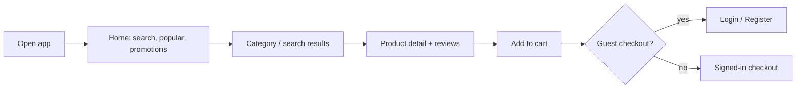
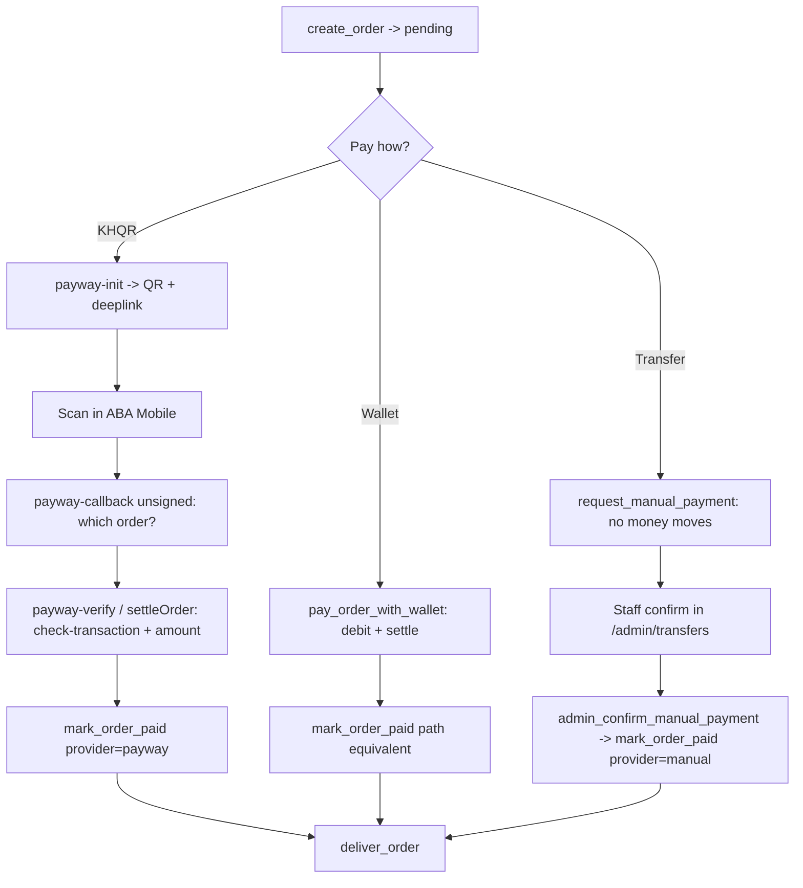
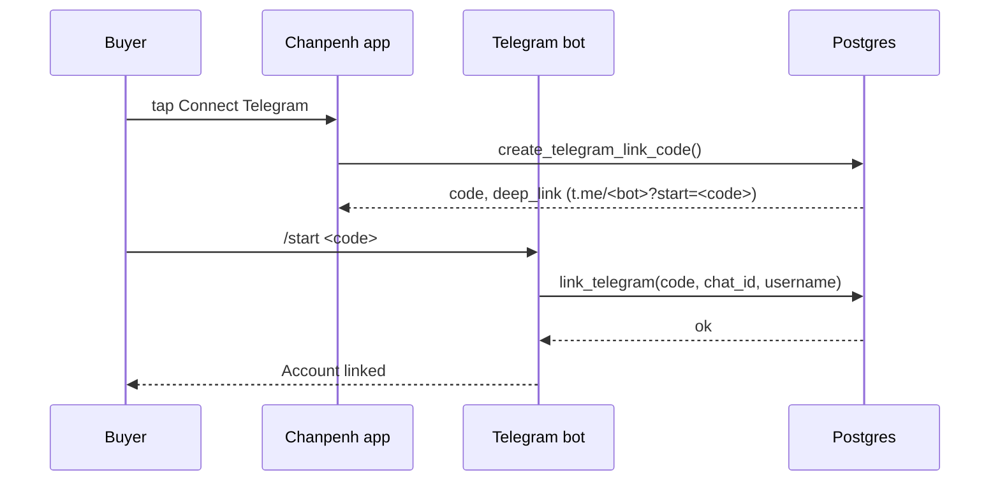
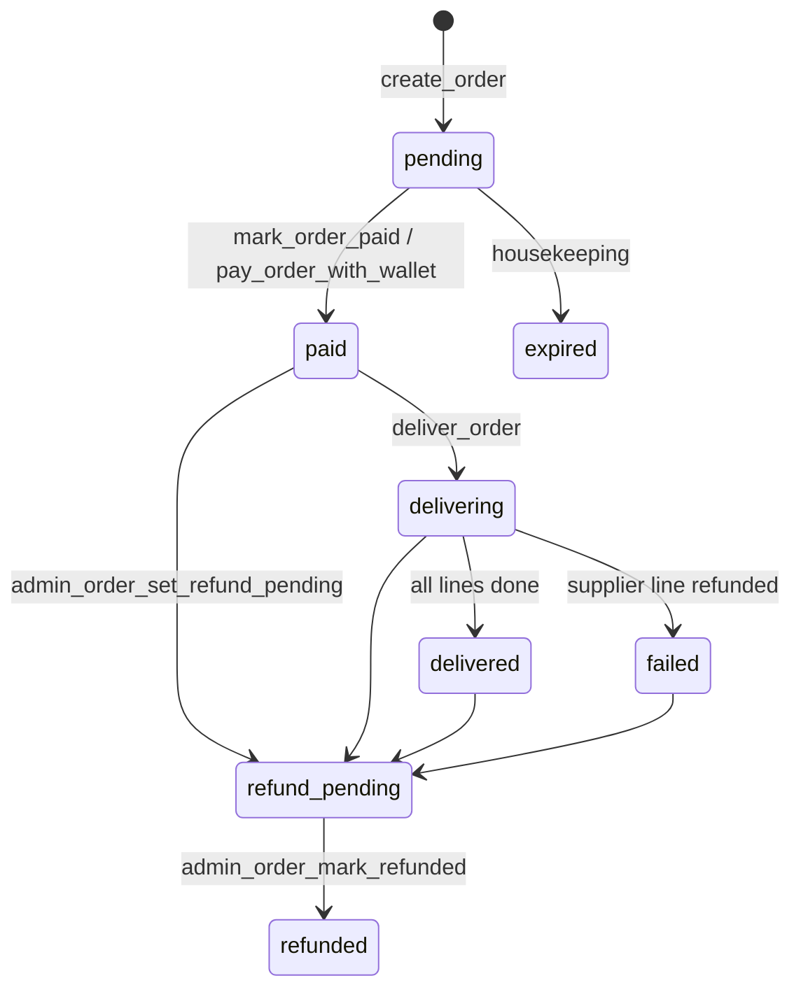

# Chanpenh — Project Guide

Team-facing walkthrough of what this product is, who uses it, how each role
flows through it, and how the partners (payments and suppliers) plug in.

Audience: engineers, ops, support staff, and anyone joining the project.

Companion documents:

- `README.md` — design rationale, setup, and the "why" behind each guardrail.
- `implement.md` — original master spec.
- `PLAN.md` — gap analysis, milestones, decisions taken, honest gaps.
- `docs/hosted-deploy.md` — the production deploy plan.
- `AGENTS.md` — repo conventions and hard invariants.

---

## 1. What this is

Chanpenh is a **Khmer-first digital storefront**. It sells game top-ups and
digital gift cards, paid with **ABA KHQR**, and delivers them instantly where
the product allows it.

- **Client:** Flutter, one codebase for web (Chrome, primary target), Android
  and iOS.
- **Backend:** Supabase only. No separate application server.
- **Money logic:** entirely in Postgres, inside `security definer` RPCs.
- **Server-side secrets:** PayWay API key, supplier keys and Telegram token live
  in Edge Function secrets and never reach the app.

### Product kinds

Every product is one of three kinds, and the kind decides how delivery happens:

| Kind | Meaning | Delivery |
|---|---|---|
| `instant_stock` | Pre-uploaded codes/keys sit in an encrypted vault | Atomic stock pick on payment |
| `auto_topup` | Supplier API credits the buyer's account | Supplier worker calls the partner API |
| `manual_setup` | A person does the work | Staff resolve the line by hand |

### Markets and language

Khmer is the default locale; English is a toggle. Currency is USD with a KHR
display rate (`usd_to_khr`, default 4100). "Today" for reporting is a **Phnom
Penh** day, computed in the store's timezone, never UTC.

---

## 2. Tech stack and repository layout

### Stack

| Layer | Technology |
|---|---|
| Client | Flutter (web + Android + iOS), Riverpod, go_router, Khmer-default i18n |
| Data access | `supabase_flutter` (PostgREST + RPC + Auth + Storage) |
| Database | Postgres 16/17 on Supabase: schema, RLS, RPCs, triggers, `pg_cron` |
| Server | Supabase Edge Functions (Deno): PayWay, supplier workers, Telegram, dev sign-in |
| Storage | `product-images` public bucket (mirrored supplier art) |
| Edge/CDN | Cloudflare Pages (app), Cloudflare Tunnel (dev), Worker API proxy, Cloudflare DNS |

### Repository layout

```
app/                      Flutter project root — run all flutter/dart here
  config/dev.json         local stack: 127.0.0.1:54321, fixed DEV_OTP
  config/prod.json        hosted project: real email OTP
  lib/src/core/           env, theme, router, formatting, field validation
  lib/src/features/*/     feature slices: data / domain per feature
  lib/src/state/          Riverpod providers, cart, locale
  lib/src/ui/             pages and widgets
  lib/l10n/               Khmer (default) + English ARB, plus generated/ (committed)
  test/                   widget and unit tests

supabase/
  migrations/             schema, RLS, business-logic RPCs (applied in filename order)
  functions/              Edge Functions (Deno); _shared/ is not deployed
  functions/.env          what LOCAL functions read (gitignored)
  seed/demo.sql           demo catalogue for local resets
  templates/              email bodies; must print {{ .Token }}
  tests/                  standalone Postgres harness, NOT part of the schema
  bundle/combined.sql     generated paste-into-SQL-editor bundle

scripts/                  dev, setup, verify-sandbox, bootstrap-admin, etc.
cloudflare/api-proxy/     Worker that forwards to the hosted Supabase project
docs/                     this guide + hosted-deploy.md + brand assets
```

---

## 3. Architecture invariants (do not break)

These three rules shape the whole design. Breaking any is how stores lose money.

1. **All money logic lives in Postgres.**
   `create_order` recomputes totals from the catalogue; client numbers are only
   a preview. A tampered client cannot buy a $10 code for $0.01.
2. **The PayWay API key never leaves the server.** It lives in Edge Function
   secrets. The app receives a QR string and a status, nothing else.
   `payway-init` builds the request and hash; `payway-verify` polls and settles.
3. **ABA is asked, never believed.** The `return_url` pushback is unsigned, so
   `payway-callback` only uses it to learn *which* order to look at. Delivery is
   decided by `check-transaction` plus an amount check, so an underpayment never
   ships goods.

Stock delivery is a single atomic statement, so two buyers can never be sold the
same code:

```sql
update private.stock_items s
   set status = 'sold', order_id = p_order_id, sold_at = now()
 where s.id in (
   select id from private.stock_items
    where variant_id = v_item.variant_id and status = 'available'
    order by created_at
    limit v_item.qty
    for update skip locked
 );
```

If fewer rows come back than were ordered, the pick is rolled back and the line
moves to the manual queue. Nothing is silently lost.

Other standing rules:

- `order_events` is **append-only**. A trigger on `orders` writes every status
  transition; no client grant can insert, change or delete a row.
- Stock payloads are encrypted at rest with `pgp_sym_encrypt`. Only
  `reveal_order` decrypts, and it re-checks ownership and paid status.
- All RPCs run with `set search_path = ''`, so every object is fully qualified.
- New schema change = new file in `supabase/migrations/`, named
  `YYYYMMDDHHMMSS_description.sql`. Never edit an applied migration.

---

## 4. Roles and permissions

Three roles exist: `customer`, `staff`, `admin`. They live on
`public.profiles.role` (enum `app_role`). Helpers `is_staff()` and `is_admin()`
are `security definer` and consult the profile, so a blocked user fails both.

| Capability | customer | staff | admin |
|---|---|---|---|
| Browse catalogue, place orders | ✅ | ✅ | ✅ |
| Reveal own codes, wallet, reviews, support tickets | ✅ | ✅ | ✅ |
| Staff screens under `/admin` (orders, refunds, support, transfers) | ❌ | ✅ | ✅ |
| Stock intake, resolve lines, price variants, approve reviews | ❌ | ✅ | ✅ |
| Supplier job queue | ❌ | ✅ | ✅ |
| Manage roles (`/admin/staff`) | ❌ | ❌ | ✅ |

### How the gate works

- **Router:** `/admin*`, `/orders*`, `/checkout`, `/wallet`, `/account` require a
  signed-in user (`router.dart` redirect).
- **UI:** `AdminGate` hides the staff surface; `adminOnly: true` hides the staff
  management screen from everyone but admins.
- **Database:** every staff RPC re-checks `is_staff()` / `is_admin()`, and every
  protected table has RLS. A route reached by hand yields nothing.

The UI gate is a convenience, never the control.

### Bootstrap and role management

- `bootstrap_admin(email)` is **not granted to any app role**. `scripts/
  bootstrap-admin.sh` runs it as the database owner once; the account must sign
  up first. "First signup wins" is therefore impossible.
- In-app: `/admin/staff` calls `admin_find_user(email)`, `admin_set_role(user,
  role)`, `admin_list_staff()`. `admin_set_role` refuses a **self-change**, so
  the acting admin always stays one, and writes an `audit_log` row.

---

## 5. Role flows

### 5.1 Guest / visitor



Guests can read the whole catalogue (products, variants, categories, approved
reviews) and the safe slice of settings via `public_settings` (site name,
support contacts, KHQR account, top-up limits). They cannot read orders, wallet,
payments, or anything staff.

### 5.2 Customer — sign-in and account

Three ways in, one screen (`/login`, `/register`):

| Method | Backing call | Notes |
|---|---|---|
| Google | `signInWithOAuth` | Button appears only when `/auth/v1/settings` says the provider is on |
| Email + password | `signUp` / `signInWithPassword` | Rules mirror `auth.minimum_password_length` and password mix in `config.toml` |
| Emailed six-digit code | `signInWithOtp` / `verifyOtp` | Fallback; only path that works before custom SMTP exists |

On signup, `private.handle_new_user` creates the `profiles` row from the auth
user: display name from metadata, and a generated `referral_code`. Registration
also collects a display name, an optional referral code, and a terms
acknowledgement. The referral code goes to `apply_referral_code`, which enforces
the rules server-side (code must exist, no self-referral, first code wins). No
money moves on a referral yet; the reward is a campaign decision.

**Dev sign-in:** with `DEV_OTP` set and `SUPABASE_URL` loopback, the `dev-signin`
Edge Function returns a real session for the fixed code. It is ignored on any
non-loopback URL (`Env.devAuthEnabled`), so a prod build cannot accept it.

Customer account surface (`/account`): display name and balances, wallet entry,
Telegram linking, staff entry (only when role is staff/admin), sign out.

### 5.3 Customer — browse, cart, checkout

1. **Browse** — home (search → trust → categories → popular → promotions →
   how it works → trust/support → all products), category pages, product detail
   with buyer-field help and reviews.
2. **Cart** — client-side lines; totals are a preview only.
3. **Checkout** — coupon preview via `validate_coupon`, required buyer fields
   collected by the shared `RequiredFieldsForm`, then `create_order`.
4. **Pay.**

Buyer fields: a product that needs an account id declares it on
`products.requires_fields`:

```json
[{"key":"userid","label_en":"Game ID","placeholder":"123456789",
  "pattern":"^[0-9]{6,12}$","help_en":"...","guide_image_url":"..."}]
```

`key` must match the supplier's own parameter name or the adapter cannot map it.
`create_order` checks presence **and** pattern **and** a 64-character cap, before
the stock check, raising `missing_fields` / `invalid_fields` with the offending
keys in `detail`. The same rules are mirrored in the app
(`core/field_validation.dart`) so the buyer is told before paying. An unusable
pattern is treated as no pattern on both sides (fail open, so a typo cannot make
a whole game unsellable).

### 5.4 Customer — payment paths

There are three payment providers, and **one settlement path**: all of them end
in `mark_order_paid`.



**Automated KHQR (preferred).** `payway-init` builds the real request + hash and
calls ABA; the app shows the QR and a deep-link to ABA Mobile; `payway-verify`
polls while the sheet is open and settles on APPROVED. `settleOrder` compares the
amount ABA reports against `orders.total_usd` and refuses to deliver on a
shortfall.

**Wallet.** `pay_order_with_wallet` row-locks the profile, checks the balance,
debits the ledger, records a `wallet` payment, and delivers — all in one
transaction. A wallet top-up is itself an order: `create_wallet_topup` makes a
`kind='wallet_topup'` pending order, paid by KHQR, and `mark_order_paid` credits
the wallet instead of delivering goods (bounded by `topup_min_usd` /
`topup_max_usd`).

**Manual transfer fallback.** For a buyer whose bank app will not open the
deeplink, or a project with no PayWay credentials. Three things make a second way
in safe:

1. **One settlement path** — staff call the same `mark_order_paid` PayWay calls.
2. **The amount is stated, not assumed** — staff type what the bank app shows;
   the RPC refuses anything below `orders.total_usd` (`manual_underpaid`).
3. **A reference settles one order** — `payments` is unique on
   `(provider, provider_ref)`; reusing one is refused (`manual_reference_used`).

Asking to pay by transfer extends `expires_at` by `manual_grace_minutes`
(default 1440) and is rate-limited (one request per order, 3/hour/user). An
**expired** order is never settled by hand; it goes down the external-refund
path instead.

### 5.5 Customer — after payment

- **Order detail** (`/orders/:id`) shows status, lines, history, and — for paid
  or delivered orders the caller owns — the decrypted codes via `reveal_order`.
- **Reviews** — a buyer can review a product from a **delivered** order. The
  insert policy requires a real purchase; reviews start `is_approved = false`;
  staff approval awards coins once and refreshes the product rating.
- **Wallet** (`/wallet`) — balance, ledger (`wallet_transactions`), top-up via
  KHQR.
- **Support** — `create_support_ticket` is own-order only, capped at five open
  tickets and one per 30 seconds.

### 5.6 Customer — Telegram bot

The bot (`@ycp_store_bot`) is a second storefront surface. Linking:



Commands: `/orders`, `/order <number>`, `/wallet`, `/help`, `/unlink`. The chat
id is **never trusted as identity**: every read goes through a definer function
that resolves `chat_id` → profile and returns only that profile's rows. Codes are
printed for paid orders only.

Notifications use a durable outbox (`notifications` table). A trigger enqueues on
`delivered` / `failed`; `telegram-dispatch` drains it. The outbox exists because
an order can be delivered minutes or hours after payment by a different actor, and
a direct send would be lost if the sender were not around.

### 5.7 Staff — operations hub (`/admin`)

`/admin` is a hub plus screens, all inside the same Flutter app behind one gate:

| Screen | Question it answers |
|---|---|
| `/admin` | What is waiting for a person, and what money actually moved |
| `/admin/orders` | Every order, filtered by status, searchable by order number |
| `/admin/orders/:id` | One order: lines + supplier state, payments, history, two refund steps |
| `/admin/refunds` | Refunds agreed but not yet reversed |
| `/admin/support` | Tickets, with status, priority and an internal note |
| `/admin/transfers` | The bank-transfer queue (confirm/dismiss) |
| `/admin/catalogue` | Products and variants: hide/show, set retail price (refused below cost) |
| `/admin/supplier-queue` | Supplier lines that are retrying or need a person |
| `/admin/staff` | (Admin only) find a user by email, change role, list staff |

**The overview does not estimate.** Every figure is a row count or a payment
sum, and the migration says what it will not do:

- **Received is summed from `payments`**, not `orders`. A wallet top-up and the
  purchase it later pays for both carry a total; summing orders double-counts.
- **Wallet spend is separate**, and is not new money.
- **Refunds are reported beside received, never netted off it.**
- **"Today" is a Phnom Penh day**, and the timezone is shown on screen.

No growth rate, no "active users", no conversion figure — each would be invented.

**Refunds stay two steps.** `refund_pending` says staff agreed; `refunded` says
the money went back. `admin_order_set_refund_pending` → `admin_order_mark_refunded`
move **no money** (the reversal happens in the bank). The automatic refund of a
failed supplier line is a *different* path that credits the buyer's wallet in
`supplier_complete_item`. Keeping them apart is what stops a refund being paid
twice.

### 5.8 Admin — role management

Admins use `/admin/staff`: find a signed-up user by email, promote to `staff` or
`admin`. `admin_set_role` refuses a self-change and is audited. To create the
first admin, run `scripts/bootstrap-admin.sh` once (see §4).

---

## 6. Partner integrations

### 6.1 Payment partner — PayWay / ABA

| Concern | Where |
|---|---|
| Create a KHQR for a pending order | `payway-init` → shared `payway.ts` builds request + hash |
| Poll and settle | `payway-verify`, shared `settle.ts` |
| Unsigned pushback | `payway-callback` (only identifies which order) |
| Settlement | `mark_order_paid` RPC (service-role only) |

Configuration lives in **Edge Function secrets**: `PAYWAY_ENV`,
`PAYWAY_MERCHANT_ID`, `PAYWAY_API_KEY`. A missing credential is reported to the
buyer as *"KHQR payments are not switched on for this project yet."*

**Stub mode.** `PAYWAY_ENV=stub` stands in for ABA so checkout, the QR sheet and
settlement all work with nothing to sign up for. Only the ABA boundary is faked:
`payway-init` builds the real request and hash, `settleOrder` runs its real amount
check, and `mark_order_paid` is the real RPC. The stub refuses to engage outside
a local stack, and its QR strings begin with `STUB-`. Knobs:
`PAYWAY_STUB_SETTLE_SECONDS`, `PAYWAY_STUB_STATE=DECLINED`,
`PAYWAY_STUB_UNDERPAY=1`.

### 6.2 Supplier partners — catalogue sync and fulfilment

Suppliers are added as one file implementing `SupplierAdapter`
(`_shared/suppliers/types.ts`). Today: **Bay2Game** (integrated) and **KAS Play**
(known, adapter not built). Keys live in Edge Function secrets.

```ts
export interface SupplierAdapter {
  readonly code: string;
  configured(): boolean;                       // is the API key present?
  canFulfil(fields: string[]): boolean;        // can it take these buyer fields?
  fieldDefinitions?(fields: string[]): FieldDefinition[];
  games(): Promise<SupplierGame[]>;
  products(gameCode: string): Promise<SupplierProduct[]>;
  fulfil(input: FulfilInput): Promise<FulfilResult>;
}
```

Two jobs, both `verify_jwt = true` (they need an `Authorization` JWT **and**
`x-job-secret`):

```bash
# Pull a supplier catalogue into your own products/variants/supplier_skus
curl -X POST "$FUNCTIONS/supplier-sync" \
  -H "Authorization: Bearer $ANON_JWT" \
  -H "x-job-secret: $SUPPLIER_JOB_SECRET" \
  -H "Content-Type: application/json" \
  -d '{"supplier":"bay2game","limit":3,"dryRun":true}'

# Drain orders that are waiting on a supplier
curl -X POST "$FUNCTIONS/supplier-fulfil" \
  -H "Authorization: Bearer $ANON_JWT" \
  -H "x-job-secret: $SUPPLIER_JOB_SECRET" -d '{"limit":10}'
```

**Pricing policy.** Synced variants are priced **at cost** until staff set a
retail price. An unpriced SKU therefore cannot be sold at a loss, only at zero
margin. `admin_variant_set_price` refuses a retail price below cost
(`price_below_cost`).

**Outcomes map to three database calls, and the distinction is the point:**

| Outcome | Effect | Why |
|---|---|---|
| `delivered` | line closed (`supplier_complete_item` success) | normal path |
| `refund` | money returned to the buyer's **wallet** | the order is genuinely undoable |
| `retry` | attempts+, exponential backoff (`supplier_note_failure`) | transient failure, or **the supplier's wallet is empty** |

Running out of supplier balance must never refund a buyer who paid correctly,
and must never silently drop the order. After five attempts the line escalates
to `manual_waiting` for staff, with the buyer's money still in place.

**Catalogue sync is atomic per game** via `supplier_upsert_catalogue`, so a
half-linked product cannot be left behind. Product art is mirrored into the
`product-images` bucket (the supplier CDN sends no CORS header and Flutter web
renders images through `fetch`); the mirror URL is built from
`STORAGE_PUBLIC_URL`.

### 6.3 Telegram as a partner channel

`telegram-webhook` (`verify_jwt = false`, protected by
`TELEGRAM_WEBHOOK_SECRET`) receives updates; `telegram-dispatch`
(`verify_jwt = true`, plus `TELEGRAM_DISPATCH_SECRET`) drains the outbox. Support
messages are forwarded to the staff chat (`support_telegram_chat_id`).

### 6.4 Sourcing policy (business, not code)

The technical layer is agnostic about where inventory comes from; the business
decision is separate and decides whether the store survives. Source from a
wholesale channel with a contract and an API. Never list a SKU you cannot source
from a contract; never price below wholesale. Deep discounts usually mean grey or
fraud-sourced codes, which get revoked after you have sold them. Netflix,
Spotify, YouTube, Canva and CapCut run no reseller programme: a store selling
those cheaply is reselling pooled or fraudulently created accounts, which ends in
chargebacks, a terminated PayWay merchant account, and liability for the seller.

---

## 7. Data model at a glance

### Enums

| Enum | Values |
|---|---|
| `product_kind` | `instant_stock`, `auto_topup`, `manual_setup` |
| `order_status` | `pending`, `paid`, `delivering`, `delivered`, `failed`, `refunded`, `expired`, `refund_pending` |
| `delivery_status` | `pending`, `delivered`, `failed`, `manual_waiting` |
| `payment_provider` | `payway`, `khqr_direct`, `wallet`, `manual` |
| `payment_status` | `initiated`, `pending`, `succeeded`, `failed`, `expired`, `refunded` |
| `wallet_kind` | `topup`, `purchase`, `refund`, `admin_adjust`, `coin_reward` |
| `stock_status` | `available`, `reserved`, `sold`, `void` |
| `app_role` | `customer`, `staff`, `admin` |

### Core tables

| Table | Purpose |
|---|---|
| `profiles` | One per auth user: role, wallet, coins, referral, Telegram link |
| `categories`, `products`, `product_variants` | Catalogue (public read) |
| `orders`, `order_items` | Orders; `kind` is `purchase` or `wallet_topup` |
| `payments` | One row per attempt; unique on `(provider, provider_ref)` |
| `wallet_transactions` | Append-only ledger with `balance_after` |
| `coupons`, `coupon_redemptions` | Discounts; never listable, validated by RPC |
| `reviews` | Requires a delivered purchase; approved by staff; coin reward once |
| `suppliers`, `supplier_skus` | Partner config and SKU mapping (SELECT to staff) |
| `order_events` | Append-only status history (trigger-written) |
| `support_tickets` | Support inbox |
| `notifications` | Telegram outbox |
| `telegram_link_codes` | Short-lived link codes |
| `audit_log` | Staff/admin action trail |

Private (never exposed through PostgREST): `private.stock_items` (encrypted
vault), `private.secrets` (stock key).

### Views

| View | Notes |
|---|---|
| `public_settings` | Safe slice of settings for the storefront (no credentials) |
| `variant_stock` | Available counts only, never payloads |
| `profile_names` | `id` + display name only, for reviews |
| `staff_manual_payments` | **`security_invoker`** — the policies on `orders` apply to the caller |

`staff_manual_payments` being `security_invoker` is load-bearing: a plain view
belongs to its owner and would hand every customer's order to any signed-in
caller.

---

## 8. Edge Functions

| Function | `verify_jwt` | Purpose |
|---|---|---|
| `payway-init` | true | Build the KHQR for a pending order; return QR + deeplink |
| `payway-verify` | true | Poll ABA and settle on APPROVED |
| `payway-callback` | false | Unsigned ABA pushback; identifies which order to check |
| `dev-signin` | false | Sandbox stand-in for email OTP; 404 unless `DEV_OTP` is set |
| `supplier-sync` | true (+ job secret) | Pull a supplier catalogue into products/variants |
| `supplier-fulfil` | true (+ job secret) | Drain auto-topup lines with a supplier API |
| `telegram-webhook` | false (+ webhook secret) | Receive Telegram updates, link accounts, answer commands |
| `telegram-dispatch` | true (+ dispatch secret) | Drain the notification outbox |

---

## 9. Order lifecycle



Per-line delivery: `pending` → `delivered` (stock/supplier/staff) or
`manual_waiting` (short pick, manual product, exhausted supplier retries). A
supplier-refunded line sets `failed`, and the order goes `failed` once no lines
are pending.

Housekeeping (`pg_cron`, every 2 minutes) expires stale pending orders, releases
stale reservations, and voids their payments. Ratings refresh every 30 minutes.

---

## 10. Security model

- **RLS everywhere in `public`.** Default privileges are revoked, then narrow
  grants are issued. The catalogue is public; everything transactional is
  own-row; the stock vault and supplier config are service-role only.
- **Writes go through RPCs.** Customers normally have only a `select` grant.
  Every mutation is a `security definer` function that re-checks ownership and
  role.
- **Secrets never leave the server.** PayWay key, supplier keys and Telegram
  token live in Edge Function secrets. The service-role key is never compiled
  into the app bundle.
- **Encryption at rest.** Stock payloads are `pgp_sym_encrypt`-ed; only
  `reveal_order` decrypts, and only for the owner or staff on a paid order.
- **Internal errors are debug-only** in the UI. A PostgREST message can name
  tables and policies, which must not be shown to a customer.
- **Rate limits inside the RPCs:** support (5 open, 30s), manual transfer
  (3/hour/user), supplier retries (5 attempts then `manual_waiting`).

---

## 11. Environments and configuration

### The two-file trap

| File | Read by | Contains |
|---|---|---|
| `.env.local` (gitignored) | hosted secrets source (`supabase secrets set`) | project ref, db password, keys, `ADMIN_EMAIL` |
| `supabase/functions/.env` (gitignored) | the **local** function runtime | `PAYWAY_*`, `DEV_OTP`, `BAY2GAME_API_KEY`, `SUPPLIER_JOB_SECRET`, `STORAGE_PUBLIC_URL` |

Putting a credential only in `.env.local` is the classic mistake: the local
function answers `*_not_configured` while the key looks present.

### Flutter configs

| File | Target | Sign-in |
|---|---|---|
| `app/config/dev.json` | local stack `127.0.0.1:54321` | fixed code, nothing emailed |
| `app/config/prod.json` | hosted project | real email OTP |

Passed via `--dart-define-from-file`. Avoid prod runs while developing: the
hosted mailer allows **2 emails/hour for the whole project**, so a few runs lock
sign-in for everyone until the window rolls over.

### Restart rules (they differ)

| Changed | Do this | Why |
|---|---|---|
| Edge Function **code** | `./scripts/dev.sh --reload-functions` | runtime snapshots functions at boot and reuses the stale isolate |
| Edge Function **env** (`supabase/functions/.env`) | `supabase stop && supabase start` | CLI bakes env into the container at creation; `docker restart` keeps old values |

### Before launch (hosted project)

- Turn off *Confirm email*; add custom SMTP.
- Paste the three templates from `supabase/templates/` into Authentication →
  Emails. Each prints `{{ .Token }}` (the app collects six digits, not a link).
- Match *Minimum password length* and character mix to `config.toml`.
- Replace the demo seed's `chanpenh@aclb` / `CHANPENH` placeholders with the real
  ABA account before taking real money.

---

## 12. Local development

From `app/` for anything Flutter; from the repo root for Supabase and scripts.

```bash
# Whole local stack: up, seed, verify, app in Chrome
./scripts/dev.sh
./scripts/dev.sh -d macos
./scripts/dev.sh --reset                # wipe and re-seed
./scripts/dev.sh --reload-functions     # after editing Edge Function code

# Flutter
cd app
flutter analyze                         # baseline: "No issues found!"
dart format lib test
flutter test                            # all widget/unit tests
flutter gen-l10n                        # after editing lib/l10n/*.arb (commit generated/)
```

Verify the layers with proof rather than assertion:

```bash
supabase/tests/run.sh                   # money-logic harness, Docker only (PG16)
./scripts/verify-sandbox.sh             # ~31 checks against the running stack
./scripts/verify-sandbox.sh --check-payway     # declined + underpaid branches
./scripts/verify-sandbox.sh --check-disabled
```

`supabase/bundle/combined.sql` is generated by `scripts/build-sql-bundle.sh`.
Never hand-edit; regenerate after adding a migration.

---

## 13. Deployment

The app deploys as static web to Cloudflare Pages; the backend is hosted
Supabase. `cloudflare/api-proxy` is a Worker that forwards requests to the
hosted project.

Production readiness is tracked in `docs/hosted-deploy.md` (currently **not
started**). Known issues recorded there:

- The linked hosted project `ozelquxztpqpjikhgnxd` has a schema but **empty
  migration history** (drift); `supabase db push` fails on the first migration.
  Decide: fresh project (recommended), reset, or adopt the existing schema.
- `chanpenh.store` returns 200 but the backend behind it is unknown.
- One Telegram bot token = one webhook URL; dev and prod cannot both receive
  updates. Switch the webhook as the last prod step.

Deploy steps, secrets list, and the webhook switch are enumerated in that file.

---

## 14. Project status

`[x]` verified, `[~]` scaffolded and compiling but not walked through live,
`[ ]` not started. Full table in `README.md`; summary:

- **Done and verified in the DB harness:** schema, RLS, RPCs, atomic stock
  delivery, wallet ledger, PayWay adapter, storefront alignment, buyer fields,
  manual transfer fallback, staff operations, wallet, reviews, referrals, role
  management, supplier fulfilment, Telegram.
- **Scaffolded `[~]`:** catalogue, cart/checkout, KHQR sheet, orders, auth —
  analyzer/tests/web-build only, not hand-walked against the running stack.
- **Not started `[ ]`:** KAS Play adapter, "verify account" button, catalogue +
  settings write path completeness, growth/referral rewards, ops (backups,
  uptime, fraud velocity), store submission.

The genuinely verified part is the database layer: `supabase/tests/run.sh`
asserts RLS isolation, the oversell guard, quantity limits, required and
pattern-validated buyer fields, coupon limits, the wallet ledger, short-pick
rollback, top-up limits, the review guard, the supplier refund path, append-only
order history, support-ticket guards, `refund_pending → refunded`, manual
transfer guards, admin overview figures, and role management.

---

## 15. Known gaps and risks

- **Live ABA is unexercised.** Stage 5 needs sandbox credentials; payment flows
  are where assumptions go to die.
- **Khmer copy needs a fluent speaker.** New customer-facing strings were written
  by a developer, not a native copywriter.
- **No hand walkthrough** of most UI screens against the running stack.
- **Dead staff policies were fixed for suppliers** (`20261016110000`), but
  `settings`, `coupons`, `audit_log` and catalogue writes still need the screens
  that will use them.
- **`resolveItem` race.** Marking a supplier line delivered by hand while the
  worker holds it is a real race the DB does not lock against.
- **Support has no reply channel** in the app; staff use the contact field
  outside it.
- **Notifications are outbox-only.** Manual payment confirmation does not notify
  the buyer; they see it when they open the order.
- **Khmer product name** is still `សេឡា` (Sela) in `Brand.nameKm`/`app_km.arb`
  while English and store identities are `Chanpenh`. Guessing a transliteration
  would be inventing a brand name; a person who knows the spelling should set it.

---

## 16. Glossary

| Term | Meaning |
|---|---|
| KHQR | Cambodia's national QR standard; ABA Mobile scans it |
| PayWay | ABA's payment gateway; holds the merchant API key |
| Bakong | The national payment backbone behind KHQR |
| Settlement | The moment a payment is trusted and the order moves to `paid` |
| Short pick | A stock allocation that returns fewer rows than needed; rolled back |
| Manual queue | Lines needing a person: short picks, manual products, exhausted retries |
| Outbox | `notifications` table that buffers Telegram messages until a dispatcher sends them |
| Definers RPC | `security definer` Postgres function; runs with the owner's rights, used for all writes |
